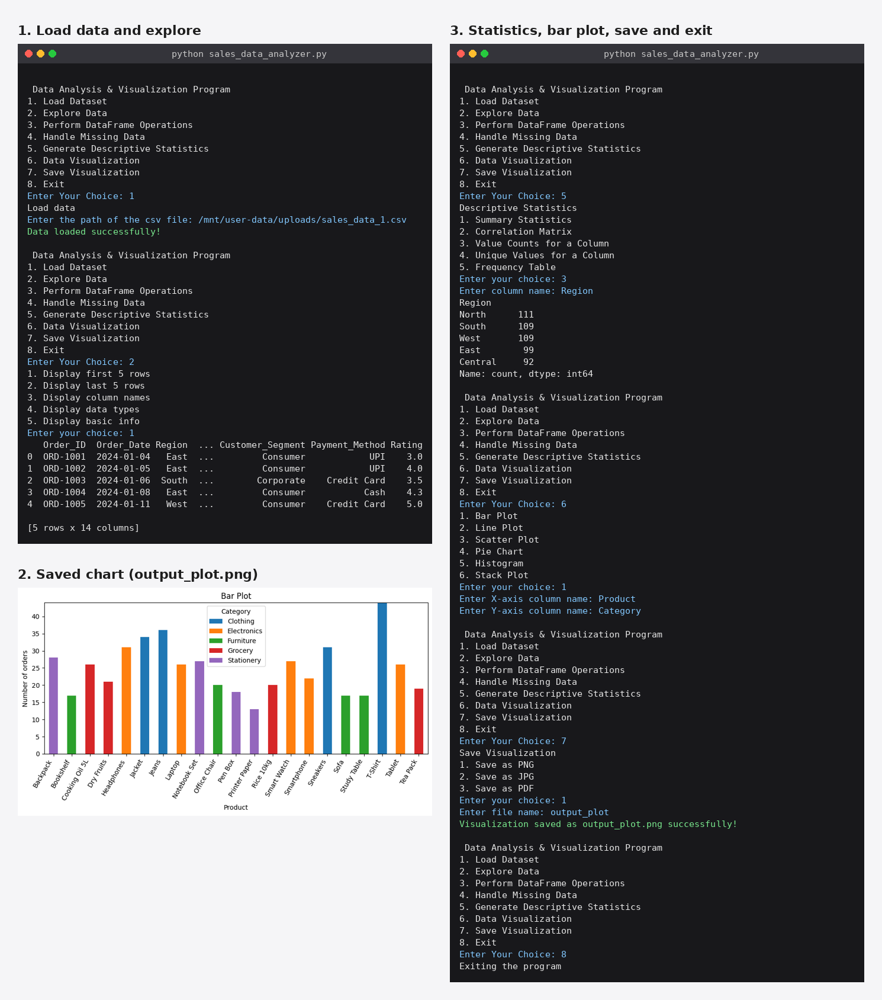

# 📊 Sales Data Analyzer

A menu-driven Python console program for **loading, exploring, cleaning, analysing and visualising** a sales dataset stored in a CSV file. It is built with **pandas**, **NumPy** and **matplotlib**, and everything is done through simple numbered menus, so no coding is needed to use it.

## ✨ Features

| Menu option | What it does |
|-------------|--------------|
| 1️⃣ 📂 Load Dataset | Reads a CSV file from the path you enter |
| 2️⃣ 🔍 Explore Data | First 5 rows, last 5 rows, column names, data types, basic info |
| 3️⃣ 🛠️ Perform DataFrame Operations | Select columns, filter rows, sort by a column, group and average |
| 4️⃣ 🧹 Handle Missing Data | Show rows with missing values, fill with mean, drop rows, or replace with a value |
| 5️⃣ 🧮 Generate Descriptive Statistics | Summary statistics, correlation matrix, value counts, unique values, frequency table |
| 6️⃣ 📈 Data Visualization | Bar plot, line plot, scatter plot, pie chart, histogram, stack plot |
| 7️⃣ 💾 Save Visualization | Saves the last chart as PNG, JPG or PDF |
| 8️⃣ 🚪 Exit | Closes the program |

## 📦 Requirements

- 🐍 Python 3.8 or newer
- numpy, pandas, matplotlib, seaborn

```bash
pip install numpy pandas matplotlib seaborn
```

## 🚀 How to run

1. Put `sales_data_analyzer.py` and your CSV file (for example `sales_data.csv`) in the same folder.
2. Open a terminal in that folder and run:

```bash
python sales_data_analyzer.py
```

3. Choose **1** and enter the CSV file name or full path.
4. Use the other options in any order. Options 2 to 7 need the data to be loaded first.

## 🗂️ Dataset

The program was tested with a sales dataset of **520 rows and 14 columns**:

`Order_ID`, `Order_Date`, `Region`, `City`, `Category`, `Product`, `Quantity`, `Unit_Price`, `Discount`, `Sales`, `Profit`, `Customer_Segment`, `Payment_Method`, `Rating`

⚠️ `Quantity`, `Discount`, `Profit` and `Rating` contain 15 missing values each.

---

## 🖼️ Walkthrough with screenshots

### 🏠 1. Main menu

The program opens with the main menu. Type the number of the task you want.


### 📂 2. Load the dataset and explore it

Option 1 loads the CSV file. Option 2 lets you look at the data: first rows, last rows, column names, data types and basic info.


### 🛠️ 3. DataFrame operations

Option 3 selects columns, filters rows with a condition such as `Sales > 100000` or `Region == 'East'`, sorts by a column, and groups data to calculate the average. The example below filters the high-value orders and then finds the average profit for each region.


### 🧹 4. Handle missing data

Option 4 fixes missing values. Here the missing values are filled with the column mean, and the basic info afterwards shows that every column now has 520 non-null values.


### 🧮 5. Descriptive statistics

Option 5 gives the correlation matrix, value counts, unique values, frequency tables and summary statistics. Below are the correlation matrix of the numeric columns and the number of orders in each region.


### 📈 6. Data visualisation

Option 6 draws six types of charts.

**📊 Bar plot.** `Product` on X and `Category` on Y counts the orders of each product, coloured by category. A numeric Y column such as `Sales` shows the average instead.


**📉 Line plot.** `Order_Date` on X and `Sales` on Y shows how sales change over time.


**🔵 Scatter plot.** `Sales` against `Profit` shows how the two are related.


**🥧 Pie chart.** The share of orders for each `Category`.


**📶 Histogram.** How the `Sales` values are distributed.


**🏔️ Stack plot.** `Sales` and `Profit` stacked over the order sequence.


### 💾 7. Save a visualisation

Draw a chart first with option 6, then choose option 7 and pick PNG, JPG or PDF.


### 🛡️ 8. Error handling

The program does not crash on wrong input. It shows a clear message when no data is loaded, the file path is wrong, a letter is typed instead of a number, or a column name does not exist.


---

## 📏 Chart rules

- 📊 **Bar plot:** the Y column can be numeric (shows the average) or text (shows the number of orders for each pair).
- 🔢 **Line, scatter, histogram and stack plot:** these need numeric columns such as `Quantity`, `Unit_Price`, `Discount`, `Sales`, `Profit` or `Rating`. If a text column is entered, the program lists the numeric columns instead.
- 🥧 **Pie chart:** best with a text column that has few unique values, such as `Region`, `Category` or `Payment_Method`.

## 📁 Project structure

```
Sales-Data-Analyzer/
├── main.py     
├── sales_data.csv
├── output.png
├── stack_plot
├── README.md

```
## Output 


## 👤 Author
 
**Parmar Vishal**


Created as a Python data analysis and visualisation project using pandas and matplotlib.